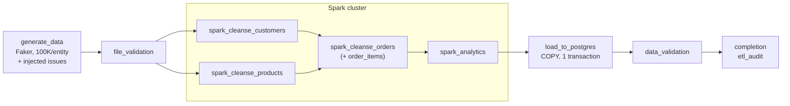

# DATA 430 Project 2: Data Processing and Analytics with Apache Spark

This project extends the Project 1 ETL pipeline. **Airflow** schedules and coordinates the work, **Apache Spark** does the processing (cleansing, deduplication, analytics), and **PostgreSQL** stores the clean data and the computed metrics. Everything runs in Docker with one command.



| Layer | What it does | Where |
|---|---|---|
| Airflow 2.10 (LocalExecutor) | Schedules daily at 06:00, triggers each Spark job with `spark-submit`, retries and alerts | `dags/etl_spark_pipeline.py` |
| Spark 3.5 standalone (1 master + 1 worker) | Reads raw CSV/JSON, cleans and dedupes, writes Parquet, computes analytics | `scripts/spark_*.py` |
| PostgreSQL 16 | Holds the Airflow metadata DB plus the `retail_dw` warehouse (clean tables, `analytics` schema, `etl_audit`) | `sql/schema.sql` |

## 1. Prerequisites (Windows)

- **Docker Desktop** with the WSL 2 backend. In *Settings → Resources*, give Docker at least **6 GB of memory** (8 GB is better) and 4 CPUs.
- **Git**.
- Free ports: 8080 (Airflow), 8081/8082 (Spark UIs), 4040–4041 (Spark job UI), 5433 (PostgreSQL), 8888 (optional Jupyter).

> Clone into a short path without spaces, e.g. `C:\data430\project2`. For faster file access you can clone inside WSL (`\\wsl$\Ubuntu\home\<you>\project2`) and run the same commands there.

## 2. Setup

```powershell
git clone <your-repo-url> project2
cd project2
copy .env.example .env          # then open .env and change the passwords / secret key
docker compose build            # first time only, about 5-10 minutes
docker compose up -d
docker compose ps               # wait until every service shows "healthy"/"running"
```

The `.env` file holds every credential and setting. `docker-compose.yml` only references variables from it, so no secrets are hardcoded. `.env` is git-ignored; `.env.example` is the template you commit.

| URL | What |
|---|---|
| http://localhost:8080 | Airflow UI (login from `AIRFLOW_ADMIN_USER` / `AIRFLOW_ADMIN_PASSWORD`) |
| http://localhost:8081 | Spark master UI (shows the worker and every submitted application) |
| http://localhost:4040 | Spark job UI while a job is running (4041 for the second parallel job) |
| `localhost:5433` | PostgreSQL for pgAdmin/DBeaver: database `retail_dw`, user/password from `.env` |

## 3. Running the pipeline

**From the UI:** open `etl_spark_pipeline`, switch the pause toggle on, then click **▶ Trigger DAG**. Use *Trigger DAG w/ config* to change `records`; for example, `1000` gives a 1-minute smoke test.

**From the CLI:**
```powershell
docker compose exec airflow-scheduler airflow dags unpause etl_spark_pipeline
docker compose exec airflow-scheduler airflow dags trigger etl_spark_pipeline
docker compose exec airflow-scheduler airflow dags trigger etl_spark_pipeline --conf '{\"records\": 1000}'
```

A full 100K run takes about 3–5 minutes. Each run writes to its own folders, keyed by the run timestamp (e.g. `20261107T110000`):

| Folder | Contents |
|---|---|
| `data/raw/<run>/` | `customers.csv`, `products.json`, `orders.csv`, `order_items.csv`, `generation_manifest.json` (what was injected) |
| `data/cleaned/<run>/<entity>/` | Clean Parquet per entity |
| `data/rejected/<run>/<entity>/` | Every dropped record with its `reject_reason` (Parquet) |
| `data/analytics/<run>/` | 17 metrics as Parquet, plus `csv/<metric>.csv` for Excel |
| `data/reports/<run>/` | `cleansing_summary.csv`, per-entity stats JSON, `analytics_summary.json`, Spark join plan |
| `data/logs/<run>/` | Timestamped log file of every Spark job |

**Checking the results in PostgreSQL:**
```powershell
docker compose exec postgres psql -U data430 -d retail_dw
```
```sql
SELECT * FROM analytics.v_recent_pipeline_runs;          -- etl_audit: start/end, status, counts
SELECT * FROM analytics.revenue_by_customer_type;
SELECT * FROM analytics.sales_monthly ORDER BY month;
SELECT dq_flags, COUNT(*) FROM customers GROUP BY 1 ORDER BY 2 DESC LIMIT 10;
```

## 4. What the pipeline does

### Data quality: injected by `generate_data.py`, resolved by `spark_cleanse.py`

| Issue (spec §2.1.2) | Injected as | Spark's fix |
|---|---|---|
| Duplicates | 2% exact copies + 3% near-duplicates (same id, different data) | Exact: window over all columns. Near: keep the most complete record, then the most advanced order status |
| Nulls | Emails, names, product names, amounts, keys… | Null keys are dropped. Other fields get a business-rule default (`Unknown`, `Regular`, 0), or are recomputed: a null `total_amount` is rebuilt from the order's line items |
| Inconsistent formats | `new york`/`NEW YORK`, 4 phone formats, `$12.99`, `credit_card`/`CREDIT CARD`, `yes`/`Y`/`1` | Title case, `XXX-XXX-XXXX`, decimal, canonical names, boolean |
| Invalid values | Negative totals, discount > total, negative stock, future dates | Invalid orders are dropped; other values are fixed (stock → 0) and flagged |
| Orphans | Orders → missing customers; order items → missing products | Joined against the *cleaned* parent tables and dropped |
| Whitespace | Leading/trailing spaces, tabs, double spaces | Regex trim and collapse. `F.trim` alone misses tabs |
| Date formats | `2024-01-15`, `01/15/2024`, `Jan 15, 2024` | Parsed with all three patterns, stored as ISO `DATE`/`TIMESTAMP` |
| *(extra)* Malformed lines | Broken CSV/JSON lines | `PERMISSIVE` mode + `_corrupt_record`, dropped and logged |

Every dropped record is counted by reason and saved to `data/rejected/`. Every *fixed* value is listed in that row's `dq_flags` column. Results at 100K records per entity (seed 42):

| Entity | In | Out | Dropped |
|---|---:|---:|---:|
| customers | 105,064 | 99,669 | 5.1% |
| products | 105,064 | 99,714 | 5.1% |
| orders | 105,063 | 94,356 | 10.2% |
| order_items | 243,555 | 218,417 | 10.3% |

### Analytics (`spark_analytics.py`, DataFrame API + Spark SQL)

- **Customer:** lifetime value, order frequency and average order value (`customer_metrics`), type distribution, top 10 customers
- **Product:** revenue, popularity, units and average selling price per product (`product_metrics`), category performance, inventory status
- **Order:** monthly and daily sales, status breakdown, payment-method revenue, discount summary
- **Cross-entity:** revenue by customer type, top 3 categories per customer type, city revenue
- **Extra:** brand performance, sales by weekday, repeat-customer rate

Revenue is `net_amount = total_amount − discount_amount`. Product and category revenue split each order's net amount across its line items, so the totals reconcile. `data_validation` runs 34 checks, including that customer lifetime value, monthly sales and revenue by type each equal total order revenue to the cent.

### Error handling

- **Airflow:** 1 retry with exponential backoff (2 for the load), 30-minute task timeout, and a failure callback that logs and optionally posts to Slack/email. A DAG failure callback writes a `failed` row to `etl_audit` with the failed task.
- **Spark:** `PERMISSIVE` reads that catch corrupt records. Every job exits non-zero on any exception, so `spark-submit` fails the Airflow task.
- **Database:** the whole load runs in one transaction. A constraint violation or connection drop rolls back and the previous good data stays. Connections retry with backoff, and PK/FK/CHECK constraints are a last line of defence.
- **Audit:** `etl_audit` stores start/end time, duration, status, raw/clean/rejected/loaded counts and a JSON `details` column per run.

## 5. Bonus features

- **Spark vs pandas benchmark:** `docker compose exec airflow-scheduler python /opt/airflow/scripts/benchmark_pandas_vs_spark.py --sizes 1000 10000 100000 500000` writes a table and chart to `data/reports/benchmark/`. On a 2-core test machine pandas wins at ≤100K (Spark has a fixed overhead of ~2–3 s per job), but Spark's time grows much more slowly: it was 0.38× pandas' speed at 100K and 0.96× at 500K. More cores move the crossover lower.
- **Optimizations:** cached base tables, explicit broadcast joins (the plan is saved to `reports/<run>/analytics_join_plan.txt`), 16 shuffle partitions instead of 200, adaptive query execution, `localCheckpoint()` to keep query plans small during cleansing.
- **Notebook:** `docker compose --profile notebook up -d`, then open http://localhost:8888 (token = `JUPYTER_TOKEN`) and `exploratory_analysis.ipynb`.
- **Alerting:** set `SLACK_WEBHOOK_URL` and/or `ALERT_EMAIL` + SMTP settings in `.env`.

## 6. Design decisions

- **New `order_items` table.** The spec's order schema has no product link, but product and category analytics need one. `order_items` (order_id, product_id, quantity, unit_price) adds it without changing the `orders` columns. Products also gained `created_date` so the "date formats in all entities" issue applies to them too.
- **`spark_cleanse_orders` waits for customers *and* products**, because order items are checked against cleaned products.
- **One Docker image for Airflow and Spark.** The driver runs in the Airflow scheduler (client mode), and PySpark requires the driver and executors to use the same Python version. Building both from one image guarantees identical Python 3.10, Spark 3.5.4 and Java 17.
- **Shared volume.** `./data` is mounted at the same path in Airflow and Spark containers, so executors read and write the same files the driver sees.

## 7. Troubleshooting

| Symptom | Fix |
|---|---|
| `airflow-init` exits with an error | `docker compose logs airflow-init`. Usually a typo in `.env`; then `docker compose up -d` again |
| Spark task stuck at "Initial job has not accepted any resources" | Docker has too little memory or CPU; raise it, or lower `SPARK_EXECUTOR_MEMORY` |
| `/bin/bash^M: bad interpreter` or odd parse errors | Windows line endings; `git config core.autocrlf false`, re-clone (`.gitattributes` enforces LF) |
| Port already in use | Change the left side of the port mapping in `docker-compose.yml` (or `POSTGRES_HOST_PORT`) |
| Start completely fresh | `docker compose down -v` (deletes the database volume), delete `data/*/` run folders |

## 8. Project structure

```
dags/etl_spark_pipeline.py        Airflow DAG (spark-submit via BashOperator)
scripts/generate_data.py          Faker generator + quality-issue injection
scripts/spark_cleanse.py          PySpark cleansing / dedup (one entity per call)
scripts/spark_analytics.py        PySpark analytics (17 outputs)
scripts/spark_utils.py            SparkSession, logging, paths, stats tracker, column helpers
scripts/load_postgres.py          Parquet -> PostgreSQL (COPY, single transaction)
scripts/pipeline_checks.py        file + data validation, etl_audit, alerts
scripts/benchmark_pandas_vs_spark.py   bonus benchmark
sql/schema.sql                    clean tables, analytics schema, etl_audit
config/spark_config.json          SparkSession settings + business rules
config/log4j2.properties          quieter Spark logs in Airflow
docker/Dockerfile                 Airflow 2.10.5 + Java 17 + PySpark 3.5.4 image
docker/postgres/                  creates the retail_dw database on first start
notebooks/exploratory_analysis.ipynb
docker-compose.yml  requirements.txt  .env.example  .gitignore  .gitattributes
```
